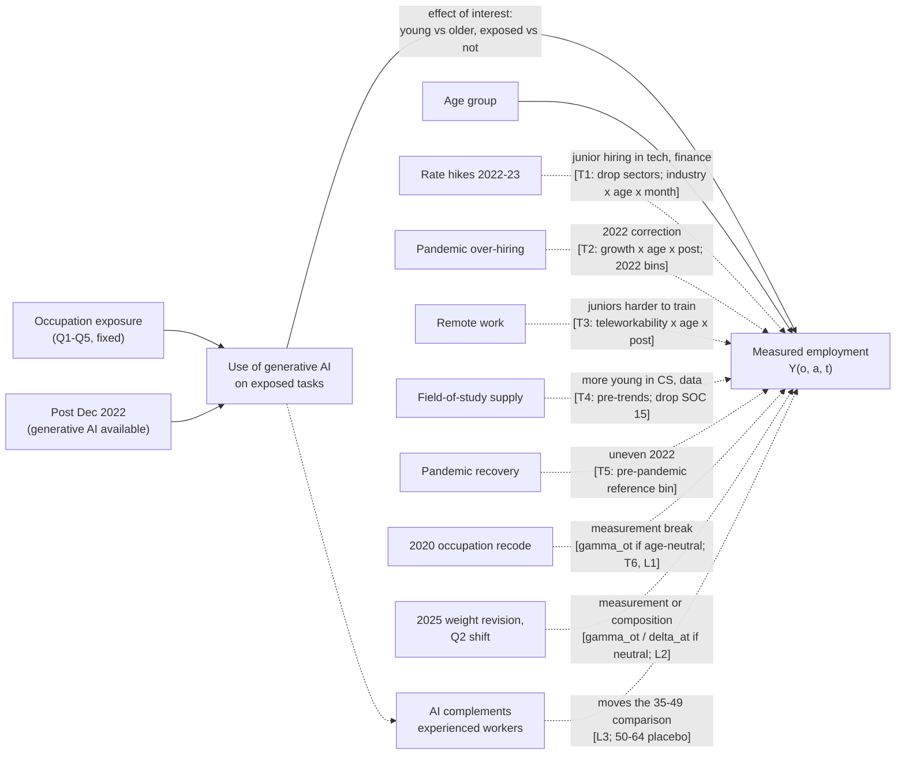

# Identification

How the preregistered design (Sections 2, 8, 11, 12) identifies its estimand: the assumption,
what the fixed effects absorb, a causal diagram, and the map from each threat to its test.
Written in Phase 7 (2026-11-03), before any model was estimated. Nothing here changes the design;
changes go to `deviations.md`. Checks marked *exploratory* are not preregistered (Section 10)
and are always labelled as such.

## 7.1 Estimand and identifying assumption

**Unit.** Occupation `o` (OCC2010) x age group `a` x month `t`. Outcome `Y_oat` = weighted
employment count (sum of WTFINL), Section 6.

**Model (Section 8).**

    E[Y_oat] = exp( SUM over q in {2..5}, a in {22-25, 26-34} of beta_qa * 1[Q_o = q] * 1[a] * Post_t
                    + alpha_oa + gamma_ot + delta_at )

Reference groups: Q1 occupations and ages 35-49. Headline: `beta_(5, 22-25)`, reported as
`exp(beta) - 1`.

**Estimand.** The proportional change, after December 2022, in employment of 22-25-year-olds
relative to 35-49-year-olds in Q5 occupations, beyond the same young-to-older change in Q1
occupations. It is a relative effect: it compares young with older workers inside the same
occupations, and exposed with unexposed occupations. It does not measure the absolute effect of AI
on young workers' employment, and it cannot say whether AI moved the young, the older, or both.

**Identifying assumption (Section 11), in potential outcomes.** Let `Y_oat(0)` be employment
without generative AI. The model is identified if

    log E[Y_oat(0)] = alpha_oa + gamma_ot + delta_at

that is, without AI the young-to-older employment ratio inside an occupation would have changed
after December 2022 in the same proportion in Q5 as in Q1 occupations. Equivalently: no shock that
varies at occupation x age x time and is correlated with exposure x post.

**What each fixed effect absorbs.**

| Fixed effect | Absorbs | Examples from this project |
|---|---|---|
| `alpha_oa` occupation x age | Every occupation's permanent age mix | Q1 has more young workers than Q4 (C4) |
| `gamma_ot` occupation x month | Any shock to an occupation that hits all its ages in the same proportion | Quintile-level pre-trends (B2: Q4 grew 11 points 2015-2019); the 2025 Q2 shift if age-neutral; 2020 code breaks if age-neutral; occupation demand cycles |
| `delta_at` age x month | Any economy-wide shock to one age group | Youth labour-market cycle; cohort size; annual population-control revisions by age that are common across occupations |

**What they cannot absorb.** A shock that changes young workers' employment relative to older
workers' *within* an occupation, more in exposed than in unexposed occupations, after December
2022. Every threat in 7.3 and 7.4 is a candidate shock of this kind.

**Further assumptions the design relies on.**
- *No anticipation.* Employment did not respond to generative AI before December 2022 (earlier
  tools such as GPT-3 and Copilot existed). Anticipation would show up as pre-period movement in
  the event study and would bias the headline toward zero. Test: the Section 11 pre-trend rule.
- *Exposure is a fixed attribute of the occupation.* Eloundou et al. rated O*NET tasks with GPT-4
  in 2023, after the treatment date. The ratings describe task content, not employment, so the
  assumption is that the post-treatment rating did not respond to employment changes. Quintile
  cutoffs use pre-period employment only (Section 5).
- *Exposure measured with error.* The crosswalk averages scores across SOC targets (Phase 4).
  Classical error in exposure attenuates the quintile contrast toward zero.
- *No spillover onto the comparison groups.* If AI raised demand for experienced workers in
  exposed occupations, or changed Q1 occupations, the estimate mixes those changes into the
  headline (see L3).

## 7.2 Causal diagram

Solid arrows: the effect of interest. Dashed arrows: threat paths. Labels in brackets name the
fixed effect that blocks a path, or the test that probes a path it cannot block.

## 7.3 Threats and tests: the seven preregistered threats (Section 12)

| # | Threat | Why the fixed effects do not absorb it | Test (preregistered) | Data needed | Status |
|---|---|---|---|---|---|
| T1 | Rate hikes cut junior hiring more in tech and finance | Hits young workers more than older ones, in sectors where exposed occupations concentrate: an occupation x age x time shock correlated with exposure | (a) Drop tech and finance (sectors 1 and 2, `TECH_AND_FINANCE_SECTORS`); (b) add industry x age x month fixed effects | `panel_occ_sector_age_month.parquet` (built 7.6b; sums to the main panel exactly, tested) | Ready |
| T2 | Post-pandemic over-hiring correction | Exposed occupations may have over-hired juniors in 2021-22 and corrected after; the correction is age-specific within occupation | Control: occupation pre-treatment growth x age x post; inspect the 2022 event-study bins | Occupation growth over `threat2_growth_window` (built 7.6a; 464 of 466 defined) | Ready |
| T3 | Remote work makes juniors harder to train | Teleworkable occupations overlap with exposed ones; any training penalty falls on the young within the occupation | Control: teleworkability x age x post | Dingel and Neiman `occ_onet_scores/output/occupations_workathome.csv` (found 7.5); code system `[verify]` on download | Download awaits Aryan |
| T4 | More young people studied CS, data, business | Changes the supply of young workers to exposed occupations; an age x occupation x time shift | (a) Event-study pre-trends; (b) drop computer and mathematical occupations (proposed definition: OCC2010 codes whose SOC targets are all in SOC major group 15) | Field of degree confirmed absent from CPS (7.5) | (a) ready for Phase 8; (b) built with the default rule (14 occupations), Aryan to confirm. Partial test; reported as a limitation |
| T5 | Uneven pandemic recovery in 2022 | Recovery speed may differ by age within occupation, and by exposure | Pre-pandemic reference bin (Dec 2019-Feb 2020); pandemic months kept with quintile x age x pandemic indicators | Panel flags `pandemic`, `main_sample` exist | Ready |
| T6 | January 2020 occupation code change | Absorbed by `gamma_ot` if a break moves all ages alike; not if reclassification differs by age | Phase 4 coverage report; Dec 2019 vs Jan 2020 jumps by occupation | Done: coverage report (Phase 4); Stage A, A2 (8 of 165 flagged, spread across quintiles) | Done; the age-differential part is L1 |
| T7 | Design finds effects where none exist | Not a confounder: a check that the estimator does not manufacture effects | Placebo dates Dec 2017 and Dec 2018, 2015-01 to 2020-02 only | Panel ready | Ready |
| - | Placebo group | Same model with ages 50-64 in place of 22-25, against 35-49 | Preregistered warning sign | Panel ready | Ready |

Section 12's reading rule applies to T1-T3: a shrinking estimate under these controls means the
design cannot separate AI from that threat, not that AI had no effect.

## 7.4 Threats learned from the data (exploratory, Section 10)

| # | Threat | Where it was seen | Why the fixed effects may not absorb it | Check (exploratory) | Status |
|---|---|---|---|---|---|
| L1 | 2020 occupation code breaks that differ by age | Stage A, A2: 8 flagged occupations (Q1 3, Q2 1, Q3 1, Q5 3), all small but Teacher Assistants | An age-neutral break is absorbed by `gamma_ot`; a recode that moved young and older workers differently is not | Re-estimate without the 8 flagged occupations | Ready for Phase 9 |
| L2 | 2025 weight revision and the Q2 shift | Open checks: Q2 share +0.6 (Jan) and +0.9 (spring) points in 2025, against under 0.25 in other years; part weights, part records | Absorbed if neutral across ages within occupation; not if the revision or the shift differs by age and exposure | (a) Unweighted counts (Section 13, preregistered); (b) end the sample at Dec 2024 (exploratory) | Ready for Phase 9 |
| L3 | The comparison group moves | Stage C: about a third of the raw C3 gap is Q5 rising relative to Q1 among 35-49-year-olds | Not a bias in the estimand, which is relative by construction, but a reader may take the headline as "young workers fell" | Report, beside the headline, the Q5-vs-Q1 change within 35-49 alone and within 22-25 alone (two DiDs, labelled exploratory), plus the preregistered 50-64 placebo | Phase 8, labelled |
| L4 | Shrinking sample | Stage A, A1: about 76,000 records a month in 2011, 48,000 in 2026; a further step down after Oct 2025 | Not a bias; lowers power where the effect would appear | Minimum detectable effect (Section 16, done: about 8.6%); report CI widths | Done |

## 7.5-7.6 results (2026-11-04)

- **Field of degree (T4):** confirmed absent. The IPUMS CPS core education group holds EDUC,
  HIGRADE, EDUC99, EDCYC, EDDIPGED, EDHGCGED, COLLEG75 and SCHLCOLL only; none records a field of
  study. T4 stays a partial test, reported as a limitation.
- **Teleworkability (T3):** Dingel and Neiman publish occupation-level results at
  `occ_onet_scores/output/occupations_workathome.csv` in github.com/jdingel/DingelNeiman-workathome.
  The README does not state the O*NET-SOC version; that is checked on download. If the codes are
  SOC 2010, the Census crosswalk's own 2010 SOC column maps them to 2010 Census codes, so no
  extra file is needed. Download awaits Aryan.
- **HonestDiD (Section 13):** a Python package `honestdid` exists on PyPI (version 0.1.1,
  uploaded 2026-03-03, development status Beta, placeholder author email). Not installed. Its
  reliability is not established; Phase 9 would need to validate it against the original R
  package's published example before use, or log a deviation (Section 13's own rule).
- **Threat 2 growth (7.6a):** log(mean monthly employment, Mar 2019-Feb 2020) minus log(mean,
  Jan-Dec 2015), all ages pooled; 464 of 466 occupations defined (2 have zero employment at one
  end). Median +0.017, 10th-90th percentile -0.34 to +0.30.
- **T4(b) computer and mathematical occupations:** default rule (all SOC targets in group 15)
  gives 14 codes: 1005, 1006, 1007, 1010, 1020, 1030, 1050, 1060, 1105, 1106, 1200, 1220, 1240,
  5800. 5800 (computer operators) is in because the 2018 SOC folds it into 15-1299. 1107
  (computer occupations, all other) is out because one target is 13-1082; an "any target" rule
  would include it.
- **T1 sector panel (7.6b):** `panel_occ_sector_age_month.parquet`, 2,675 occupation-sector pairs
  x 4 age groups x 187 months; every employed record has a sector.

## Status summary

- Ready for Phase 8: the headline, T5, T7, placebo group, T4(a), L3.
- Ready for Phase 9: T1, T2, T4(b) (default rule), L1, L2.
- Awaiting Aryan: T3 (download), T4(b) rule confirmation, HonestDiD package (install and validate).
- Done: T6, L4.
